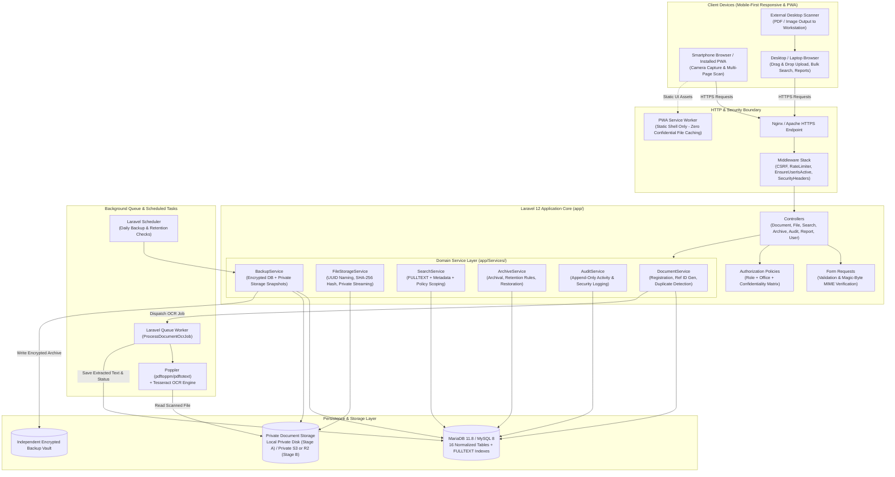
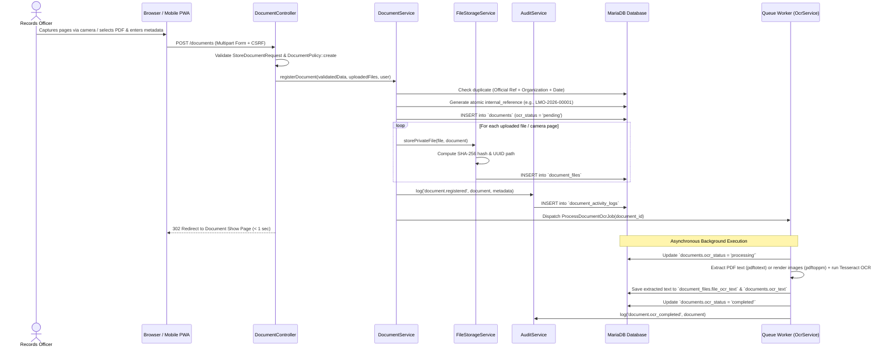

# System Architecture: LMO Digital Records Management System (DRMS)

**Document Version:** 1.0 (Phase 1 Deliverable)  
**Architectural Pattern:** Modular Laravel 12 Monolith with Asynchronous Queue Processing  
**Target Runtime:** PHP 8.4+, MariaDB 11.8 / MySQL 8.0+ (PostgreSQL Portable), Tesseract OCR + Poppler Utils  

---

## 1. Architectural Philosophy & Design Principles

The **LMO Digital Records Management System (DRMS)** is engineered for long-term institutional sustainability, high security, low operational overhead, and effortless handover to government IT personnel.

1. **Modular Monolith Architecture:** Rather than splitting the application into fragile microservices that require complex container orchestration, all domain logic lives inside a single well-structured Laravel 12 codebase divided into clear domain layers (`Controllers` → `FormRequests` → `Policies` → `Services` → `Models`).
2. **Strict Server-Side Authorization (Defense in Depth):** Every HTTP request passes through authentication middleware, active-account verification, and Laravel Authorization Policies (`DocumentPolicy`, `UserPolicy`, `AuditLogPolicy`). UI button visibility is strictly cosmetic; security is enforced at the controller and query-scope levels.
3. **Private-By-Default Document Storage:** Physical files (scanned PDFs, JPEGs, PNGs) are never stored in `public/`. They are written to a private disk (`storage/app/private/documents/{YYYY}/{MM}/` in development or a private S3/Cloudflare R2 bucket in production) under a random UUID filename. File previews and downloads are streamed through an authenticated controller that checks permissions and writes an immutable audit log entry before returning bytes.
4. **Asynchronous Heavy Processing:** Optical Character Recognition (OCR) and system backups run in background Laravel Queue jobs (`ProcessDocumentOcrJob`, `RunSystemBackupJob`) so user-facing registration requests finish in under 1 second.
5. **Append-Only Accountability:** The `DocumentActivityLog` model disables updates and deletions at the application layer, ensuring a tamper-evident audit trail for every document view, download, edit, archive action, permission change, and unauthorized access attempt.

---

## 2. High-Level System Architecture Diagram



---

## 3. Core Module Interactions & Workflows

### 3.1 Document Registration & Asynchronous OCR Sequence



### 3.2 Secure Document Viewing & Download Workflow
1. User clicks **Preview** or **Download** on a document attachment (`GET /documents/{document}/files/{file}/download` or `/preview`).
2. `DocumentFileController` invokes `$this->authorize('view', $document)`.
3. `DocumentPolicy::view(User $user, Document $document)` verifies:
   - The user account `is_active === true`.
   - If the user is not a `system_admin`, the user belongs to the document's `office_id` OR has an active `document_assignments` record for the document.
   - If `confidentiality_level` is `confidential` or `strictly_confidential`, the user holds an authorized role (`records_manager`, `office_manager`), is the original `registered_by` officer (for `confidential`), or is explicitly assigned to the document.
4. **If Denied (403):** `AuditService` logs `document.unauthorized_access_attempt` with the user ID, document ID, IP address, and user agent before aborting with HTTP 403.
5. **If Authorized (200):** `AuditService` logs `document.downloaded` or `document.viewed`, and `FileStorageService` streams the file from `storage/app/private/...` with `Content-Disposition` and `Cache-Control: private, no-store, no-cache, must-revalidate` headers.

---

## 4. Directory & Code Organization

```text
app/
├── Console/Commands/
│   ├── RunBackupCommand.php          # CLI command for encrypted DB + storage backup
│   └── VerifyBackupCommand.php       # CLI command to verify backup integrity
├── Http/
│   ├── Controllers/
│   │   ├── Auth/                     # Login, Logout, Password Reset, MFA Controllers
│   │   ├── DashboardController.php   # Executive KPIs & operational charts
│   │   ├── DocumentController.php    # Registration, show, edit, duplicate check, retry OCR
│   │   ├── DocumentFileController.php# Secure private preview, download, multi-file upload
│   │   ├── SearchController.php      # Global Full-Text & metadata search engine
│   │   ├── ArchiveController.php     # Archive action, Archive Vault search, restoration
│   │   ├── AssignmentController.php  # Routing & approvals workflow
│   │   ├── AuditLogController.php    # Admin immutable audit dashboard & security alerts
│   │   ├── ReportController.php      # PDF & CSV/Excel institutional exports
│   │   ├── CategoryController.php    # Document category administration
│   │   ├── OfficeController.php      # Office & department administration
│   │   └── UserController.php        # Staff management, role assignment, activation toggle
│   ├── Middleware/
│   │   ├── EnsureUserIsActive.php    # Immediately blocks deactivated accounts
│   │   └── SecurityHeaders.php       # Enforces CSP, X-Frame-Options, X-Content-Type-Options
│   └── Requests/
│       ├── StoreDocumentRequest.php
│       ├── UpdateDocumentRequest.php
│       └── ArchiveDocumentRequest.php
├── Jobs/
│   └── ProcessDocumentOcrJob.php     # Asynchronous Tesseract + Poppler execution
├── Models/
│   ├── Office.php
│   ├── Department.php
│   ├── Role.php
│   ├── Permission.php
│   ├── User.php
│   ├── DocumentCategory.php
│   ├── Document.php
│   ├── DocumentFile.php
│   ├── DocumentTag.php
│   ├── DocumentActivityLog.php
│   ├── DocumentAssignment.php
│   ├── DocumentApproval.php
│   ├── DocumentArchive.php
│   ├── SystemSetting.php
│   └── BackupLog.php
├── Policies/
│   ├── DocumentPolicy.php
│   ├── UserPolicy.php
│   └── AuditLogPolicy.php
└── Services/
    ├── DocumentService.php
    ├── FileStorageService.php
    ├── OcrService.php
    ├── SearchService.php
    ├── ArchiveService.php
    ├── AuditService.php
    └── BackupService.php
```

---

## 5. Portability Between Stage A (Prototype) and Stage B (Production)

| Architectural Concern | Stage A (Self-Funded Prototype) | Stage B (Government Production) | Required Code Change |
| :--- | :--- | :--- | :--- |
| **Database Engine** | Local MariaDB 11.8 / MySQL 8 | Managed MySQL 8 / MariaDB / PostgreSQL | **Zero** (Configured via `DB_CONNECTION` in `.env`) |
| **Document File Storage** | `local` private disk (`storage/app/private`) | `s3` private disk (Cloudflare R2 / AWS S3 / MinIO) | **Zero** (Configured via `FILESYSTEM_DISK=s3` in `.env`) |
| **Queue Driver** | `database` queue table | `database` or `redis` | **Zero** (Configured via `QUEUE_CONNECTION` in `.env`) |
| **OCR Engine** | Local `tesseract` + `pdftoppm` binaries | Server `tesseract` + `pdftoppm` binaries | **Zero** (Paths configurable via `OCR_TESSERACT_PATH` in `.env`) |
| **Backups** | Local encrypted `.tar.gz.enc` archives | Offsite S3 / Institutional SAN encrypted vault | **Zero** (Configured via `BACKUP_DISK` in `.env`) |
