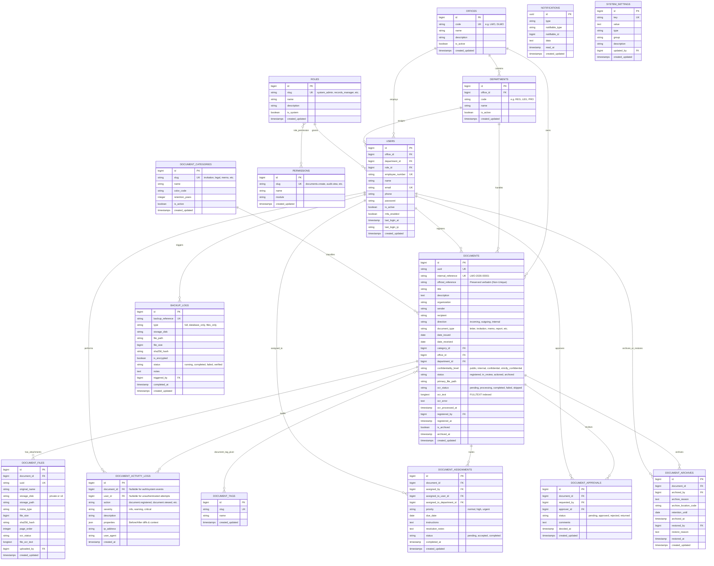

# Database Design & Data Dictionary: LMO Digital Records Management System (DRMS)

**Document Version:** 1.0 (Phase 1 Deliverable)  
**Target DBMS:** MariaDB 11.8.9 / MySQL 8.0+ (Portable to PostgreSQL 15+)  
**Character Set & Collation:** `utf8mb4` / `utf8mb4_unicode_ci`  
**Database Name:** `lmo_records`  

---

## 1. Database Design Principles

1. **Preserve Official Reference Numbers Verbatim:** Different external ministries, agencies, and private organizations often use overlapping or unstandardized reference numbers (e.g., `REF/01/2026`, `ADM/12`, or `Unnumbered`). Therefore, `documents.official_reference` is indexed for fast search and duplicate-warning checks, but is **not** constrained to be globally unique. Instead, `documents.internal_reference` (e.g., `LMO-2026-00001`) serves as the globally unique institutional tracking identifier.
2. **Multi-File & Multi-Page Architecture:** While `documents` stores the primary storage reference and consolidated OCR text for fast single-table querying, the companion `document_files` table supports unlimited attachments or individual camera-captured pages per document with explicit `page_order`, SHA-256 integrity hashes, and per-file OCR extraction.
3. **Full-Text Search Indexing:** A MariaDB/MySQL `FULLTEXT` index (`ft_documents_search`) spans `official_reference`, `title`, `description`, `organization`, `sender`, `recipient`, and `ocr_text` to enable sub-second keyword retrieval across tens of thousands of scanned pages.
4. **Immutable Accountability (`document_activity_logs`):** Foreign keys on audit logs use `NULL ON DELETE` or restrict deletion of users/documents so historical accountability records can never be cascaded away.
5. **Relational Integrity & Portability:** All tables use standard Laravel migration primitives (`foreignId`, `string`, `text`, `longText`, `json`, `timestamp`, `boolean`) so the schema can migrate cleanly onto MariaDB, MySQL, or PostgreSQL.

---

## 2. Entity-Relationship (ER) Diagram



---

## 3. Comprehensive Data Dictionary (16 Core Domain Tables + Pivot & Framework Support)

### 3.1 `offices`
Stores institutional offices (initially the Lord Mayor's Office, extensible to Deputy Lord Mayor's Office or other directorates).
| Column | Type | Nullable | Indexing / Constraints | Description |
| :--- | :--- | :---: | :--- | :--- |
| `id` | `BIGINT UNSIGNED` | No | `PRIMARY KEY`, Auto-Increment | Unique office identifier |
| `code` | `VARCHAR(20)` | No | `UNIQUE` | Short institutional prefix (e.g., `LMO`) used in internal tracking IDs |
| `name` | `VARCHAR(150)` | No | Indexed | Official office name (e.g., `Lord Mayor's Office`) |
| `description` | `TEXT` | Yes | — | Optional description of the office mandate |
| `location` | `VARCHAR(150)` | Yes | — | Building / floor location (e.g., `City Hall, 2nd Floor`) |
| `is_active` | `BOOLEAN` | No | Default `true` | Whether the office is active for new registrations |
| `created_at`, `updated_at` | `TIMESTAMP` | Yes | — | Standard audit timestamps |

### 3.2 `departments`
Stores internal units or divisions within an office (e.g., Central Registry, Legal Affairs, Protocol & Invitations, Executive Secretariat, Administration).
| Column | Type | Nullable | Indexing / Constraints | Description |
| :--- | :--- | :---: | :--- | :--- |
| `id` | `BIGINT UNSIGNED` | No | `PRIMARY KEY` | Unique department ID |
| `office_id` | `BIGINT UNSIGNED` | No | `FOREIGN KEY (offices.id)` | Parent office |
| `code` | `VARCHAR(30)` | No | `UNIQUE(office_id, code)` | Department code (e.g., `REG`, `PROT`, `LEG`) |
| `name` | `VARCHAR(150)` | No | — | Department name |
| `description` | `TEXT` | Yes | — | Optional notes |
| `is_active` | `BOOLEAN` | No | Default `true` | Active status |
| `created_at`, `updated_at` | `TIMESTAMP` | Yes | — | Standard timestamps |

### 3.3 `roles` & `permissions` (plus `role_permission` pivot)
Provides configurable Role-Based Access Control (RBAC).
- **`roles` Columns:** `id`, `slug` (`UNIQUE`: `system_admin`, `records_manager`, `records_officer`, `office_manager`, `read_only`), `name`, `description`, `is_system` (`BOOLEAN`), `created_at`, `updated_at`.
- **`permissions` Columns:** `id`, `slug` (`UNIQUE`: e.g., `documents.view`, `documents.create`, `documents.edit`, `documents.download`, `documents.view_confidential`, `documents.view_strictly_confidential`, `documents.archive`, `documents.restore`, `documents.assign`, `documents.approve`, `ocr.retry`, `reports.view`, `reports.export`, `audit.view`, `users.manage`, `settings.manage`, `backups.manage`), `name`, `module`, `description`, `created_at`, `updated_at`.
- **`role_permission` Columns:** `role_id` (`FK`), `permission_id` (`FK`), Composite Primary Key `(role_id, permission_id)`.

### 3.4 `users`
Stores authorized staff accounts and security metadata.
| Column | Type | Nullable | Indexing / Constraints | Description |
| :--- | :--- | :---: | :--- | :--- |
| `id` | `BIGINT UNSIGNED` | No | `PRIMARY KEY` | Unique user ID |
| `office_id` | `BIGINT UNSIGNED` | Yes | `FOREIGN KEY (offices.id)` | Assigned office (enforces office separation) |
| `department_id` | `BIGINT UNSIGNED` | Yes | `FOREIGN KEY (departments.id)` | Assigned internal unit |
| `role_id` | `BIGINT UNSIGNED` | No | `FOREIGN KEY (roles.id)` | Assigned RBAC role |
| `employee_number`| `VARCHAR(50)` | Yes | `UNIQUE` | Institutional staff/ID number |
| `name` | `VARCHAR(150)` | No | Indexed | Full name of officer |
| `title` | `VARCHAR(100)` | Yes | — | Official job title (e.g., `Senior Records Officer`) |
| `email` | `VARCHAR(150)` | No | `UNIQUE` | Official login email |
| `phone` | `VARCHAR(30)` | Yes | — | Contact telephone number |
| `password` | `VARCHAR(255)` | No | — | Bcrypt/Argon2id hashed password |
| `is_active` | `BOOLEAN` | No | Default `true`, Indexed | Deactivated users are immediately blocked by middleware |
| `mfa_enabled` | `BOOLEAN` | No | Default `false` | Optional MFA status for privileged accounts |
| `mfa_secret` | `TEXT` | Yes | Encrypted | Optional TOTP secret |
| `last_login_at` | `TIMESTAMP` | Yes | — | Timestamp of most recent login |
| `last_login_ip` | `VARCHAR(45)` | Yes | — | IPv4/IPv6 of most recent login |
| `remember_token`| `VARCHAR(100)` | Yes | — | Session remember token |
| `created_at`, `updated_at` | `TIMESTAMP` | Yes | — | Standard timestamps |

### 3.5 `document_categories`
Stores classification categories, explicitly supporting **Invitations** alongside official correspondence, legal notices, petitions, circulars, and reports.
| Column | Type | Nullable | Indexing / Constraints | Description |
| :--- | :--- | :---: | :--- | :--- |
| `id` | `BIGINT UNSIGNED` | No | `PRIMARY KEY` | Unique category ID |
| `slug` | `VARCHAR(80)` | No | `UNIQUE` | URL/code identifier (e.g., `invitation`, `official-letter`) |
| `name` | `VARCHAR(120)` | No | — | Display name (e.g., `Official Invitation`) |
| `description` | `TEXT` | Yes | — | Filing guidelines for this category |
| `color_code` | `VARCHAR(20)` | No | Default `#245B91` | UI badge color hex |
| `retention_years`| `INT UNSIGNED` | No | Default `5` | Years before eligible for archival review |
| `is_active` | `BOOLEAN` | No | Default `true` | Whether selectable on registration form |
| `created_at`, `updated_at` | `TIMESTAMP` | Yes | — | Standard timestamps |

### 3.6 `documents`
The central institutional register table.
| Column | Type | Nullable | Indexing / Constraints | Description |
| :--- | :--- | :---: | :--- | :--- |
| `id` | `BIGINT UNSIGNED` | No | `PRIMARY KEY` | Internal numeric primary key |
| `uuid` | `CHAR(36)` | No | `UNIQUE` | Publicly safe route identifier |
| `internal_reference`| `VARCHAR(40)` | No | `UNIQUE` | System-generated unique ID (e.g., `LMO-2026-00001`) |
| `official_reference`| `VARCHAR(150)` | Yes | `INDEX` (Non-Unique) | Sender's exact official reference number preserved verbatim |
| `title` | `VARCHAR(255)` | No | `INDEX`, `FULLTEXT` | Document subject or heading |
| `description` | `TEXT` | Yes | `FULLTEXT` | Summary, executive brief, or registration notes |
| `organization` | `VARCHAR(200)` | No | `INDEX`, `FULLTEXT` | Originating or destination institution/ministry/company |
| `sender` | `VARCHAR(200)` | Yes | `INDEX`, `FULLTEXT` | Name/title of person who signed or sent the document |
| `recipient` | `VARCHAR(200)` | Yes | `INDEX`, `FULLTEXT` | Addressee (e.g., `The Right Honourable Lord Mayor`) |
| `direction` | `VARCHAR(20)` | No | Default `incoming`, `INDEX` | `incoming`, `outgoing`, or `internal` |
| `document_type` | `VARCHAR(50)` | No | Default `letter`, `INDEX` | `letter`, `invitation`, `memo`, `report`, `legal_notice`, `petition`, `circular`, `other` |
| `event_date` | `DATETIME` | Yes | `INDEX` | Optional event date/time (specifically useful when `category = Invitation`) |
| `date_issued` | `DATE` | Yes | `INDEX` | Date written on the physical document |
| `date_received` | `DATE` | No | `INDEX` | Date received at the office |
| `category_id` | `BIGINT UNSIGNED` | No | `FOREIGN KEY` | Links to `document_categories.id` |
| `office_id` | `BIGINT UNSIGNED` | No | `FOREIGN KEY`, `INDEX` | Owning office (`offices.id`) |
| `department_id` | `BIGINT UNSIGNED` | Yes | `FOREIGN KEY`, `INDEX` | Responsible department (`departments.id`) |
| `confidentiality_level`| `VARCHAR(30)`| No | Default `internal`, `INDEX` | `public`, `internal`, `confidential`, `strictly_confidential` |
| `status` | `VARCHAR(30)` | No | Default `registered`, `INDEX`| `draft`, `registered`, `in_review`, `actioned`, `archived` |
| `primary_file_path`| `VARCHAR(500)` | Yes | — | Storage reference to primary attachment |
| `file_count` | `INT UNSIGNED` | No | Default `0` | Count of attached files/pages in `document_files` |
| `ocr_status` | `VARCHAR(25)` | No | Default `pending`, `INDEX` | `pending`, `processing`, `completed`, `failed`, `skipped` |
| `ocr_text` | `LONGTEXT` | Yes | `FULLTEXT` | Consolidated OCR text extracted from all document files |
| `ocr_error` | `TEXT` | Yes | — | Error diagnostic if OCR failed |
| `ocr_processed_at`| `TIMESTAMP` | Yes | — | When OCR completed |
| `registered_by` | `BIGINT UNSIGNED` | No | `FOREIGN KEY (users.id)` | Records officer who registered the document |
| `registered_at` | `TIMESTAMP` | No | `INDEX` | Exact registration timestamp |
| `is_archived` | `BOOLEAN` | No | Default `false`, `INDEX` | Fast filter flag for active vs. archived records |
| `archived_at` | `TIMESTAMP` | Yes | — | Timestamp of most recent archive action |
| `created_at`, `updated_at` | `TIMESTAMP` | Yes | — | Standard timestamps |

### 3.7 `document_files`
Stores individual uploaded files or multi-page mobile camera captures belonging to a document.
| Column | Type | Nullable | Indexing / Constraints | Description |
| :--- | :--- | :---: | :--- | :--- |
| `id` | `BIGINT UNSIGNED` | No | `PRIMARY KEY` | File record ID |
| `document_id` | `BIGINT UNSIGNED` | No | `FOREIGN KEY (documents.id)` | Parent document |
| `uuid` | `CHAR(36)` | No | `UNIQUE` | Used in secure download/preview URLs |
| `original_name` | `VARCHAR(255)` | No | — | Original client filename (sanitized) |
| `storage_disk` | `VARCHAR(30)` | No | Default `local` | Storage disk (`local` private disk or `s3`) |
| `storage_path` | `VARCHAR(500)` | No | — | Private path (`private/documents/2026/11/{uuid}.pdf`) |
| `mime_type` | `VARCHAR(100)` | No | — | Verified MIME type (`application/pdf`, `image/jpeg`, `image/png`) |
| `extension` | `VARCHAR(15)` | No | — | File extension |
| `file_size` | `BIGINT UNSIGNED` | No | — | Size in bytes |
| `sha256_hash` | `CHAR(64)` | No | `INDEX` | Cryptographic SHA-256 digest for integrity verification |
| `page_order` | `INT UNSIGNED` | No | Default `1` | Sequence order for multi-page camera captures |
| `capture_source` | `VARCHAR(30)` | No | Default `upload` | `upload`, `camera_scan`, or `external_scanner` |
| `ocr_status` | `VARCHAR(25)` | No | Default `pending` | Per-file OCR processing state |
| `file_ocr_text` | `LONGTEXT` | Yes | — | Extracted text for this specific file/page |
| `uploaded_by` | `BIGINT UNSIGNED` | No | `FOREIGN KEY (users.id)` | Officer who uploaded the file |
| `created_at`, `updated_at` | `TIMESTAMP` | Yes | — | Standard timestamps |

### 3.8 `document_tags` & `document_tag_pivot`
Allows flexible cross-cutting tags (e.g., `Urgent`, `Budget FY2026/27`, `Council Session`, `VIP Invitation`, `KCCA`).
- **`document_tags` Columns:** `id`, `slug` (`UNIQUE`), `name`, `created_at`, `updated_at`.
- **`document_tag_pivot` Columns:** `document_id` (`FK`), `document_tag_id` (`FK`), Composite Primary Key `(document_id, document_tag_id)`.

### 3.9 `document_activity_logs` (Append-Only Audit Trail)
Records every security, user, and document lifecycle event.
| Column | Type | Nullable | Indexing / Constraints | Description |
| :--- | :--- | :---: | :--- | :--- |
| `id` | `BIGINT UNSIGNED` | No | `PRIMARY KEY` | Log entry ID |
| `document_id` | `BIGINT UNSIGNED` | Yes | `FOREIGN KEY`, `INDEX` | Affected document (nullable for auth/user management events) |
| `user_id` | `BIGINT UNSIGNED` | Yes | `FOREIGN KEY`, `INDEX` | Acting user (nullable for failed login attempts) |
| `office_id` | `BIGINT UNSIGNED` | Yes | `FOREIGN KEY`, `INDEX` | Office scope of the event |
| `action` | `VARCHAR(80)` | No | `INDEX` | e.g., `document.registered`, `document.viewed_confidential`, `document.downloaded`, `document.updated`, `document.archived`, `document.restored`, `security.unauthorized_access`, `user.role_changed` |
| `severity` | `VARCHAR(20)` | No | Default `info`, `INDEX` | `info`, `warning`, `critical` |
| `description` | `VARCHAR(500)` | No | — | Human-readable summary of the event |
| `properties` | `JSON` | Yes | — | Structured context (changed fields before/after, filename, etc.) |
| `ip_address` | `VARCHAR(45)` | Yes | `INDEX` | Client IPv4/IPv6 address |
| `user_agent` | `VARCHAR(500)` | Yes | — | Browser / device user agent string |
| `created_at` | `TIMESTAMP` | No | `INDEX` | Immutable creation timestamp (no `updated_at` column) |

### 3.10 `document_assignments`, `document_approvals`, `document_archives`, `notifications`, `system_settings`, `backup_logs`
- **`document_assignments`:** Tracks internal routing of a document to an officer (`assigned_to_user_id`) or department (`assigned_to_department_id`) with `priority`, `due_date`, `instructions`, `resolution_notes`, and `status`.
- **`document_approvals`:** Tracks executive or managerial sign-off decisions (`pending`, `approved`, `rejected`, `returned`) with `comments` and `decided_at`.
- **`document_archives`:** Stores full archival history (`document_id`, `archived_by`, `archive_reason`, `archive_location_code`, `retention_until`, `archived_at`, `restored_by`, `restore_reason`, `restored_at`) so multiple archive/restore cycles are preserved without losing history.
- **`notifications`:** Standard Laravel database notification table for real-time in-app alerts.
- **`system_settings`:** Configurable institutional parameters (`institution_name`, `office_code_prefix`, `max_upload_size_mb`, `ocr_languages`, `default_retention_years`).
- **`backup_logs`:** Tracks automated and manual backup jobs (`backup_reference`, `type`, `storage_disk`, `file_path`, `file_size`, `sha256_hash`, `is_encrypted`, `status`, `triggered_by`, `completed_at`).

---

## 4. Database Setup Instructions

### 4.1 Create the MariaDB / MySQL Database
Run the following command to create the `lmo_records` database with full Unicode support:
```bash
mysql -u root -p -e "CREATE DATABASE IF NOT EXISTS lmo_records CHARACTER SET utf8mb4 COLLATE utf8mb4_unicode_ci;"
```

### 4.2 Configure `.env` in Laravel
```dotenv
DB_CONNECTION=mysql
DB_HOST=127.0.0.1
DB_PORT=3306
DB_DATABASE=lmo_records
DB_USERNAME=root
DB_PASSWORD="!Log19tan88"
```

### 4.3 Run Migrations and Institutional Seeders
```bash
php artisan migrate --seed
```
